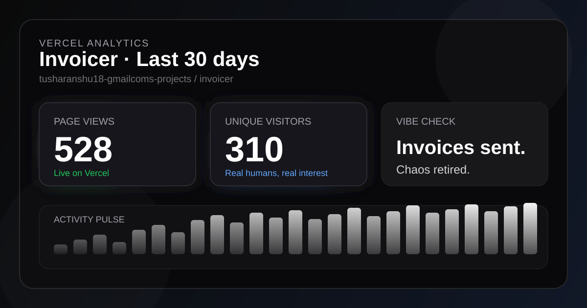

# Invoicer

Invoicer is a web application for creating and managing invoices Users can sign in create invoices track payments download invoices and send invoices by email

## Analytics



| Metric last 30 days | Count |
| --- | ---: |
| Page views | 528 |
| Unique visitors | 310 |

## Features

- Create invoices with business details client details line items tax discount and notes
- View a list of invoices and invoice details
- Download invoices as PNG
- Send invoices as PDF by email
- Record payments and track balance due
- Add payment links
- Issue corrections and keep invoice history
- Dashboard for invoice overview
- Demo page for creating one invoice without signing in

## Tech Stack

| Layer | Technology |
| --- | --- |
| Framework | Next.js 16 App Router |
| UI | React 19 Tailwind CSS 4 |
| Authentication | Clerk |
| Database | PostgreSQL Neon |
| ORM | Prisma 7 |
| PDF | pdfkit |
| Email | nodemailer |
| Language | TypeScript |

## Routes

| Route | Description |
| --- | --- |
| `/` | Landing page |
| `/demo` | Demo invoice page |
| `/sign-in` | Sign in page |
| `/sign-up` | Sign up page |
| `/dashboard` | Dashboard |
| `/invoices` | Invoice list |
| `/invoices/new` | Create invoice |
| `/invoices/[id]` | Invoice details |

## Getting Started

### 1 Install dependencies

```bash
npm install
```

### 2 Add environment variables

Create a `.env` file in the project root

```env
# Clerk
NEXT_PUBLIC_CLERK_PUBLISHABLE_KEY=pk_test_...
CLERK_SECRET_KEY=sk_test_...
NEXT_PUBLIC_CLERK_SIGN_IN_URL=/sign-in
NEXT_PUBLIC_CLERK_SIGN_UP_URL=/sign-up
NEXT_PUBLIC_CLERK_SIGN_IN_FALLBACK_REDIRECT_URL=/invoices/new
NEXT_PUBLIC_CLERK_SIGN_UP_FALLBACK_REDIRECT_URL=/invoices/new

# Database
DATABASE_URL="postgresql://..."

# Gmail SMTP
GMAIL_USER=you@gmail.com
GMAIL_APP_PASSWORD=your-16-character-app-password
```

### 3 Set up the database

```bash
npm run db:migrate
```

### 4 Run the development server

```bash
npm run dev
```

Open [http://localhost:3000](http://localhost:3000)

## Scripts

| Command | Description |
| --- | --- |
| `npm run dev` | Start development server |
| `npm run build` | Generate Prisma Client and build |
| `npm run start` | Start production server |
| `npm run lint` | Run ESLint |
| `npm run db:generate` | Generate Prisma Client |
| `npm run db:migrate` | Run migrations |
| `npm run db:push` | Push schema to database |
| `npm run db:studio` | Open Prisma Studio |

## Data Model

Prisma models are defined in `prisma/schema.prisma`

- **User** Application user
- **Business** Business details and invoice settings
- **Client** Client details
- **Invoice** Invoice data status totals and payment information
- **InvoiceItem** Invoice line items
- **Payment** Payment records
- **InvoiceActivity** Invoice activity history
- **InvoiceRevision** Invoice revision history

## Deployment

The project can be deployed on Vercel

- Build command `npm run build`
- Install command `npm install`
- Add required environment variables before deploying

## Notes

- Generated Prisma Client is in `app/generated/prisma` and is gitignored
- Run `npm run db:generate` after changing `prisma/schema.prisma`
- Invoice emails are sent using the configured Gmail account
